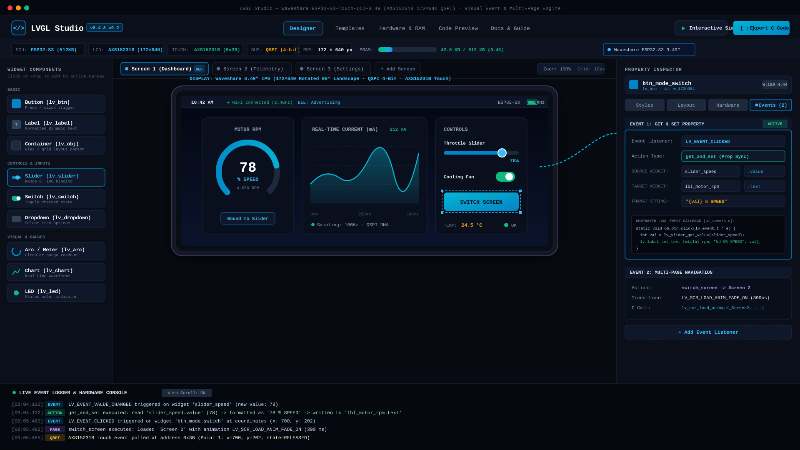

# LVGL Studio — Embedded GUI Designer & Code Generator

[](https://lvgl.io/)
[](https://espressif.com)
[](#supported-hardware--display-controllers)
[](https://platformio.org/)
[](LICENSE)

A visual drag-and-drop user interface designer and production-ready C/C++ code generator for **LVGL** (Light and Versatile Graphics Library) targeting modern microcontrollers (ESP32, ESP32-S3, ESP32-C5, Raspberry Pi RP2040/RP2350, STM32, Arduino).

---

## Dashboard Preview



*Figure 1: LVGL Studio designing a multi-screen industrial dashboard for the Waveshare ESP32-S3-Touch-LCD-3.49 featuring real-time telemetry charts, circular arc meters, interactive controls, and visual Event Listener Set & Get property binding.*

---

## Key Highlights

- **Visual Drag & Drop Canvas**: Place and configure buttons, sliders, switches, circular arcs/meters, real-time waveform charts, labels, containers, LEDs, and dropdowns with sub-pixel alignment, snapping grids, and instant live preview.
- **Multi-Page & Screen Manager**: Create, rename, clone, and manage multiple independent screens (`Screen 1`, `Screen 2`, `Screen 3`...) with default boot screen assignment and animated hardware transitions (`LV_SCR_LOAD_ANIM_FADE_ON`, `MOVE_LEFT`, `OVER_TOP`, etc.).
- **Visual Event Listener & Action Engine (Set & Get)**:
  - Wire interactions without writing boilerplate C code.
  - Bind triggers (`LV_EVENT_CLICKED`, `LV_EVENT_VALUE_CHANGED`, `LV_EVENT_PRESSED`, `LV_EVENT_RELEASED`, `LV_EVENT_LONG_PRESSED`, `LV_EVENT_FOCUSED`, `LV_EVENT_DEFOCUSED`).
  - Configure **Set & Get**: Dynamically read a property from a source widget (e.g. read slider `value` or switch `checked`) and write it into a target widget (e.g. update label `text` formatted with `"{val} % SPEED"` or `"{val} °C"`).
  - Configure **Switch Screen**: Transition seamlessly across pages on button click or gesture.
  - Configure **Toggle**: Flip widget state or toggle visibility.
- **In-Browser Interactive Simulator & Live Logger**: Test buttons, drag sliders, flip switches, and navigate across pages directly in the browser with an interactive runtime engine and real-time event execution log.
- **Hardware & RAM Estimation Engine**: Real-time calculation of internal SRAM and external PSRAM consumption based on screen resolution, color depth (RGB565 / RGB888), framebuffer sizing (1/10th, 1/5th, or full screen), and widget tree overhead.
- **One-Click Code Export (LVGL v8 & v9)**:
  - Export complete modular C code (`ui.c`, `ui.h`, `ui_events.c`, `ui_events.h`).
  - Ready-to-flash **PlatformIO** projects with pre-configured `platformio.ini` dependencies, board definitions, and build flags.
  - Ready-to-flash **Arduino IDE** sketches (`main.ino`) with bus initialization (QSPI/SPI), touch driver polling, and display flush callbacks.
  - Export full downloadable ZIP packages containing the complete firmware project.

---

## Supported Hardware & Display Controllers

| Board / Module | Microcontroller | Screen Specs | Bus Interface | Display Controller | Touch Controller |
| :--- | :--- | :--- | :--- | :--- | :--- |
| **Waveshare ESP32-S3-Touch-LCD-3.49** | ESP32-S3 (8MB PSRAM) | 3.49″ IPS Bar (172 × 640) | QSPI 4-Bit | AXS15231B | **AXS15231B Integrated Touch** (I2C `0x3B`) |
| **Waveshare ESP32-C5-LCD-2.73** | ESP32-C5 (WiFi 6 / BLE 5) | 2.73″ IPS (320 × 320) | SPI / QSPI | ST7789 / ST7789T3 | None / Resistive |
| **LilyGO T-Display S3** | ESP32-S3 (8MB PSRAM) | 1.9″ IPS (170 × 320) | 8-Bit Parallel (I80) | ST7789V | CST816S (I2C `0x15`) |
| **CYD (Cheap Yellow Display)** | ESP32-WROOM-32 | 2.8″ TFT (240 × 320) | SPI | ST7789 / ILI9341 | XPT2046 (SPI) |
| **Round Smart Watch AMOLED** | ESP32-S3 | 1.43″ Round (466 × 466) | QSPI | SH8601 | FT6236 / CST816S |
| **Touch Rotary Dial AMOLED** | ESP32-S3 | 1.2″ Round (390 × 390) | QSPI | SPD2010 | SPD2010 Integrated |
| **M5Stack CoreS3** | ESP32-S3 (8MB PSRAM) | 2.0″ IPS (320 × 240) | SPI / I2C | ILI9342C | FT6336U (I2C `0x38`) |
| **Generic / Custom Boards** | ESP32, S3, C5, RP2040, STM32 | Custom (e.g. 800×480 RGB) | QSPI / SPI / I80 / RGB | All standard drivers | GT911, FT6236, CST816S, XPT2046 |

---

## Detailed Board Configuration

### 1. Waveshare ESP32-S3-Touch-LCD-3.49

The **ESP32-S3-Touch-LCD-3.49** combines a wide 172×640 IPS bar display with an all-in-one **AXS15231B** controller that manages both QSPI display drive and capacitive touch sensing on the same IC.

```
                    ┌───────────────────────────────────────────────┐
                    │      Waveshare ESP32-S3-Touch-LCD-3.49        │
                    ├──────────────────────┬────────────────────────┤
                    │ Display (QSPI 4-Bit) │ Capacitive Touch (I2C) │
                    ├──────────────────────┼────────────────────────┤
                    │ CS:   GPIO 10        │ SDA:  GPIO 15          │
                    │ SCK:  GPIO 9         │ SCL:  GPIO 16          │
                    │ D0:   GPIO 11        │ INT:  GPIO 4           │
                    │ D1:   GPIO 12        │ RST:  GPIO 8           │
                    │ D2:   GPIO 13        │ ADDR: 0x3B             │
                    │ D3:   GPIO 14        │ REG:  0x02 (Touch Reg) │
                    │ RST:  GPIO 8         │                        │
                    │ BL:   GPIO 48        │                        │
                    └──────────────────────┴────────────────────────┘
```

#### AXS15231B Touch Engine Protocol
The touch engine inside the AXS15231B communicates over standard 2-Wire I2C at address `0x3B`:
```c
// Sample generated read routine for AXS15231B
bool read_axs15231b_touch(uint16_t *x, uint16_t *y) {
  Wire.beginTransmission(0x3B);
  Wire.write(0x02); // Touch status & coordinates register
  if (Wire.endTransmission(false) != 0) return false;
  
  if (Wire.requestFrom(0x3B, 5) >= 5) {
    uint8_t points = Wire.read();
    if (points == 0) return false;
    uint8_t x_high = Wire.read();
    uint8_t x_low  = Wire.read();
    uint8_t y_high = Wire.read();
    uint8_t y_low  = Wire.read();
    *x = ((x_high & 0x0F) << 8) | x_low;
    *y = ((y_high & 0x0F) << 8) | y_low;
    return true;
  }
  return false;
}
```

### 2. Waveshare ESP32-C5-LCD-2.73

The **ESP32-C5-LCD-2.73** is powered by Espressif's RISC-V 32-bit dual-band WiFi 6 (2.4 GHz + 5 GHz) and Bluetooth 5 (LE) SoC paired with a 320×320 IPS display.

- **MCU**: ESP32-C5 RISC-V (384 KB SRAM, Dual-Band 2.4/5GHz 802.11ax)
- **Display Controller**: ST7789 / ST7789T3 (320 × 320 pixels)
- **Pinout**:
  - `CS`: GPIO 10
  - `SCK`: GPIO 12
  - `MOSI`: GPIO 11
  - `DC`: GPIO 9
  - `RST`: GPIO 8
  - `BL`: GPIO 7

---

## Visual Event Listener & Action Engine

LVGL Studio features an event-driven architecture that links widget triggers directly to target actions, property mutations, and screen transitions.

### 1. Supported Event Listeners
- `LV_EVENT_CLICKED`: Triggered when a button or object is clicked/tapped.
- `LV_EVENT_VALUE_CHANGED`: Triggered when a slider, switch, or dropdown value changes.
- `LV_EVENT_PRESSED`: Fired immediately when finger/pointer touches down.
- `LV_EVENT_RELEASED`: Fired when touch is released.
- `LV_EVENT_LONG_PRESSED`: Fired when held for more than 400ms.
- `LV_EVENT_FOCUSED`: Fired when selected via keypad/encoder.
- `LV_EVENT_DEFOCUSED`: Fired when focus shifts to another element.

### 2. Action Types
- **`get_and_set` (Property Synchronization)**:
  Reads a source widget property (such as `slider.value`) and formats it into a target widget property (such as `label.text`), supporting format tokens like `"{val} %"` or `"{val} RPM"`.
- **`set_property` (Direct Value Mutation)**:
  Directly assigns a new value, text, checked state, or visibility to another widget.
- **`switch_screen` (Multi-Page Navigation)**:
  Loads another screen with animated hardware transitions (`LV_SCR_LOAD_ANIM_FADE_ON`, `LV_SCR_LOAD_ANIM_MOVE_LEFT`, etc.).
- **`toggle_widget` (Flip State)**:
  Toggles a switch state between ON and OFF or toggles visibility.
- **`custom_callback` (Custom C Logic)**:
  Generates an empty C function stub in `ui_events.c` ready for custom sensor reads, motor controls, or network requests.

### 3. Generated C Code Example
When linking a Slider to a Label with `get_and_set`, LVGL Studio produces:

```c
/* Generated in ui_events.c */
#include "ui.h"

void on_slider_speed_value_changed(lv_event_t * e) {
    lv_obj_t * src = lv_event_get_target(e);
    int32_t val = lv_slider_get_value(src);
    
    // Automatically formats and updates target label
    lv_label_set_text_fmt(ui_lbl_motor_rpm, "%d %% SPEED", (int)val);
}

void on_btn_next_page_clicked(lv_event_t * e) {
    // Hardware accelerated screen transition
    lv_scr_load_anim(ui_Screen2, LV_SCR_LOAD_ANIM_FADE_ON, 300, 0, false);
}
```

---

## Memory & Framebuffer Estimation

LVGL Studio models the memory footprint of your display before you compile:

$$\text{Framebuffer Size (Bytes)} = \text{Width} \times \text{Height} \times \text{BytesPerPixel} \times \text{BufferFraction}$$

- **16-bit Color (RGB565)**: 2 bytes per pixel
- **Single Buffer (1/10th screen)**: Minimal SRAM consumption, ideal for microcontrollers without PSRAM (e.g. RP2040, standard ESP32).
- **Double Buffer (1/5th or Full Screen)**: DMA-accelerated double buffering, tearing-free animations using PSRAM on ESP32-S3.

LVGL Studio's sub-header bar continuously monitors:
$$\text{Total Used RAM} = \text{Framebuffers} + (\text{Widget Count} \times 128\text{ B}) + \text{LVGL Core Heap}$$

---

## Project Structure

```
lvgl-studio/
├── public/
│   ├── dashboard_screenshot.png  # High-resolution dashboard screenshot
│   └── dashboard_screenshot.svg  # Vector IDE screenshot
├── src/
│   ├── components/
│   │   ├── Canvas.tsx            # Interactive visual canvas & drag handles
│   │   ├── CodeExportModal.tsx   # C/C++, Arduino & PlatformIO code viewer
│   │   ├── HardwareMemoryModal.tsx # Pinout & RAM allocation calculator
│   │   ├── LiveEventLog.tsx      # Real-time event log & simulation console
│   │   ├── PropertyInspector.tsx # Style, layout & visual event action editor
│   │   ├── ScreenManager.tsx     # Multi-page tab strip & screen controls
│   │   ├── TemplatesModal.tsx    # Board presets (Waveshare, LilyGO, CYD)
│   │   ├── TopBar.tsx            # Header navigation & export triggers
│   │   ├── WidgetPalette.tsx     # Draggable widget component library
│   │   └── WidgetRenderer.tsx    # Accurate SVG/HTML widget simulator
│   ├── types/
│   │   └── lvgl.ts               # Core interfaces, event types, MCU pinouts
│   ├── utils/
│   │   ├── hardwareConfig.ts     # MCU specifications, LCD and Touch drivers
│   │   ├── lvglCodeGen.ts        # LVGL v8/v9, Arduino and PlatformIO generator
│   │   └── templates.ts          # Ready-to-use template projects & layouts
│   ├── App.tsx                   # Central IDE state & keyboard shortcuts
│   └── main.tsx                  # React entry point
├── package.json
└── README.md
```

---

## Quick Start & Local Development

### 1. Run the Designer Locally
```bash
# Clone the repository
git clone https://github.com/your-username/lvgl-studio.git
cd lvgl-studio

# Install dependencies
npm install

# Start development server
npm run dev
```

Visit `http://localhost:3000` in your browser.

### 2. Flashing Generated Firmware to Hardware

#### Option A: PlatformIO (Recommended)
1. In LVGL Studio, click **"Export C Code"** -> **PlatformIO Project** -> **Download ZIP**.
2. Extract the ZIP archive and open the folder in **VSCode** with the **PlatformIO IDE** extension installed.
3. Connect your board via USB-C.
4. Run the upload command:
   ```bash
   pio run -t upload
   ```
5. Open the serial monitor:
   ```bash
   pio device monitor
   ```

#### Option B: Arduino IDE
1. In LVGL Studio, click **"Export C Code"** -> **Arduino Sketch (.ino)**.
2. In the Arduino Library Manager, install:
   - `lvgl` (v8.3.x or v9.x based on your selection)
   - `GFX Library for Arduino` (or board-specific display driver)
3. Copy `lv_conf.h` to your Arduino `libraries/` directory.
4. Select your board (e.g. `ESP32S3 Dev Module`) and target COM port.
5. Click **Upload**.

---

## Keyboard Shortcuts

| Shortcut | Action |
| :--- | :--- |
| `Ctrl + Z` / `Cmd + Z` | Undo last change |
| `Ctrl + Y` / `Cmd + Y` | Redo last change |
| `Ctrl + D` / `Cmd + D` | Duplicate selected widget |
| `Delete` / `Backspace` | Delete selected widget |
| `Arrow Keys` | Nudge selected widget by 1 pixel |
| `Shift + Arrow Keys` | Nudge selected widget by 10 pixels |
| `Escape` | Deselect active widget or close modal |

---

## License

This project is licensed under the [MIT License](LICENSE).
Built with passion for the embedded systems, IoT, and maker communities.
